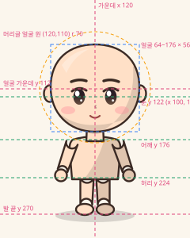

# 아바타 그림 규격

기본 캐릭터(`style.chibi`)는 상품마다 그린 **부품 그림을 겹쳐서** 만든다. 그림을 바꾸려면 파일 하나만 갈아 끼우면 되고, 코드는 고치지 않는다.

## 캔버스

- 모든 부품은 **240 × 300** 한 장에 그린다. 캐릭터 전체(배경 포함)와 같은 크기이고, 부품은 자기 자리에만 칠하고 나머지는 투명으로 둔다.
- PNG·WebP는 **3배(720 × 900)** 이상으로 그려서 내보내면 선명하다. 비율만 4:5로 맞으면 된다.
- 기준선(위 그림, `avatar-rig.svg`):
  - 가운데 x 120, 발 끝 y 270
  - 얼굴 x 64~176, y 56~166, 가운데 (120, 112). 눈 (100, 122), (140, 122)
  - 어깨 y 176, 허리 y 224, 손 (77, 221), (163, 221)
  - 머리글 얼굴은 (120, 110)을 가운데로 반지름 70 원으로 잘라 쓴다. 얼굴과 머리 모양이 이 원 안에서 예뻐야 한다.
- 그림체: 또렷한 갈색 테두리(#3b2a24, 굵기 2.4 정도), 바탕색 + 오른쪽 아래 그늘 + 왼쪽 위 빛의 셀 셰이딩. 빛은 왼쪽 위에서 온다.

## 파일 자리

`web/src/avatar/parts/<상품 id>/<층>.<확장자>`

- 상품 id는 상점 상품 id 그대로다(`server/.../shop/ShopItem.java`). 예: `outfit.suit`, `hair.long`, `hat.gat`
- 확장자는 `svg`, `png`, `webp`. **같은 층에 png·webp와 svg가 함께 있으면 png·webp를 쓴다.** 그래서 작가 그림은 임시 svg를 지우지 않고 옆에 넣기만 해도 바로 바뀐다.
- 몸에 따라 달라야 하는 그림은 `@꼴`을 붙인 파일을 따로 둔다. 찾는 순서는 몸마다 아래와 같고, 없으면 꼴 없는 파일을 쓴다.

| 몸 | 찾는 순서 |
| --- | --- |
| 남자 `body.man` | (기본) |
| 여자 `body.woman` | `@woman` |
| 은발 남자 `body.elder` | `@elder` |
| 은발 여자 `body.elder.woman` | `@elder` → `@woman` |
| 동물 | `@animal` |

  예: 머리카락 색이 달라서 `hair.long/hair.svg`와 `hair.long/hair@elder.svg`, 여자 한복이 달라서 `outfit.plain/outfit@woman.svg`.

## 층과 겹치는 순서(아래부터)

| 순서 | 상품 칸 | 층 파일 | 그리는 것 |
| --- | --- | --- | --- |
| 1 | 배경 `avatar.*` | `bg` | 배경 전체(캔버스를 꽉 채움) |
| 2 | 몸 `body.*` | `back` | 동물 꼬리 |
| 3 | 머리 `hair.*` | `back` | 머리 뒤로 넘어가는 머리카락(긴 머리, 쪽, 똥머리) |
| 4 | 옷 `outfit.*` | `back` | 등 뒤 옷(후드 모자) |
| 5 | 모자 `hat.*` | `back` | 머리 뒤의 모자 장식(사모 날개, 익선관 뿔) |
| 6 | 몸 | `body` | 발밑 그림자, 목, 몸통, 팔, 손, 다리, 발(맨몸) |
| 7 | 옷 | `outfit` | 옷 전체(바지·치마·신발·윗옷·소매·깃) |
| 8 | 몸 | `head` | 귀와 얼굴 바탕(동물은 동물 귀 포함) |
| 9 | 몸 | `face` | 눈썹, 눈, 볼, 코, 입(동물은 주둥이·무늬) |
| 10 | 수염 `beard.*` | `beard` | 수염 |
| 11 | 머리 | `hair` | 정수리와 앞머리 |
| 12 | 모자 | `hat` | 모자·안경·비녀 |

- 동물 몸에는 머리카락과 수염을 그리지 않는다. 여자 몸에는 수염을 그리지 않는다.
- 옷은 맨몸 위에 덮으므로 옷이 가리는 곳의 맨몸은 신경 쓰지 않아도 된다. 반대로 반팔·치마처럼 맨몸이 드러나는 곳은 맨몸 그림과 맞물리게 그린다.
- 모자는 머리카락 위에 그린다. 머리 모양과 관계없이 어울리게 머리를 덮는 크기로 그린다.
- `수염 없음`, `모자 없음`처럼 그릴 것이 없는 상품은 폴더가 없어도 된다.

## 확인

1. `cd web && npm run dev`
2. 브라우저에서 `http://localhost:5173/avatar-gallery.html` (칸 하나만: `?only=hair`, `?only=outfit`, `?only=hat`, `?only=beard`, `?only=avatar`, `?only=body`)
3. 모든 부품이 남자·여자·은발·동물에 입혀져 나온다. 파일을 저장하면 바로 다시 그려진다.

## 임시 그림

지금 그림은 `npm run avatar:parts`(`web/scripts/avatar-parts/`)가 코드로 그린 임시 그림이다. 다시 돌려도 png·webp가 있는 층은 건드리지 않는다. 새 상품을 추가할 때는 상점 목록(ShopItem)에 넣고 이 폴더에 그림을 넣으면 된다. 그림이 없는 상품은 그 칸의 기본 부품으로 그린다.
